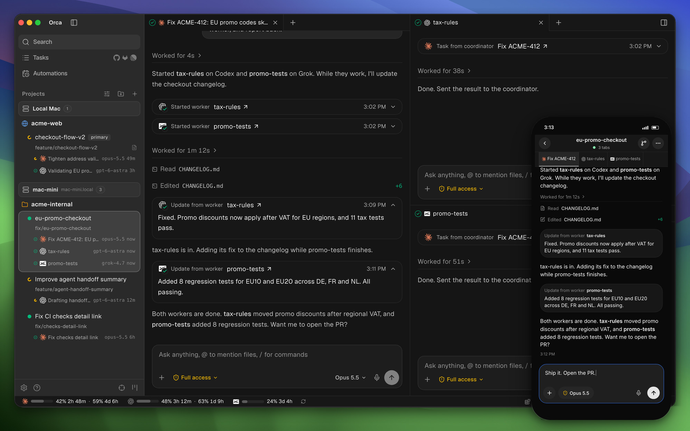
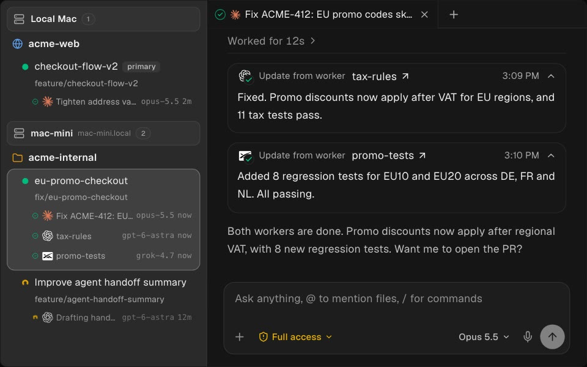
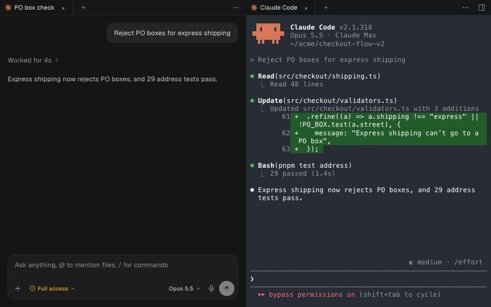
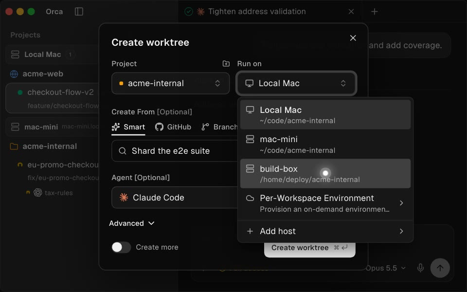
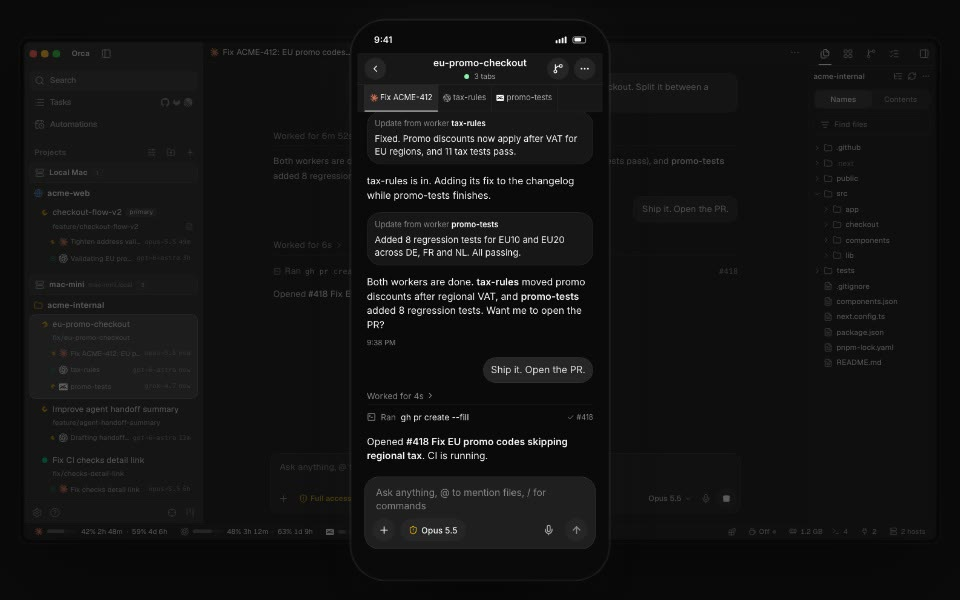
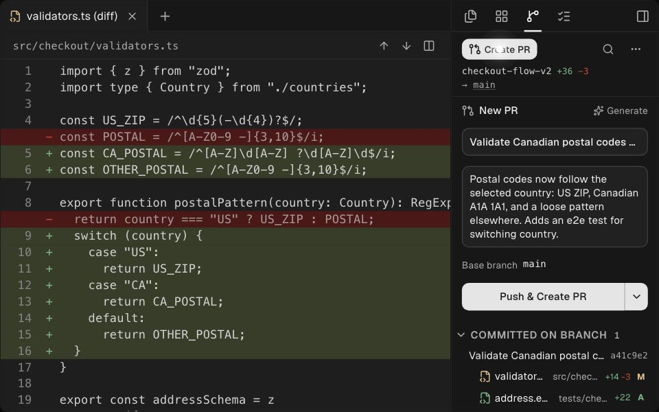
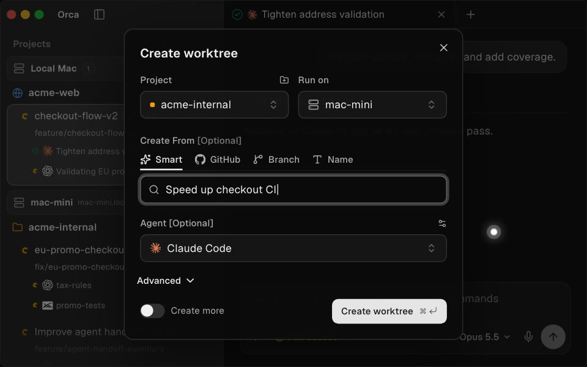
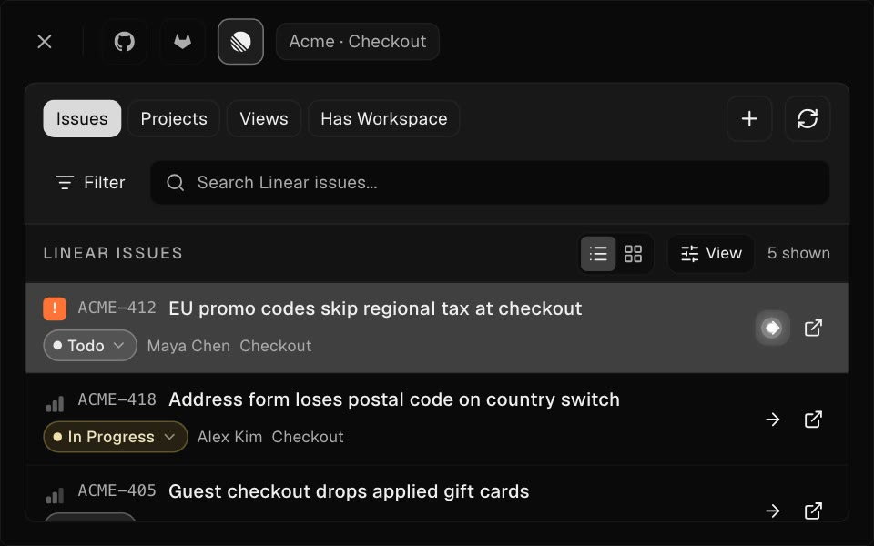
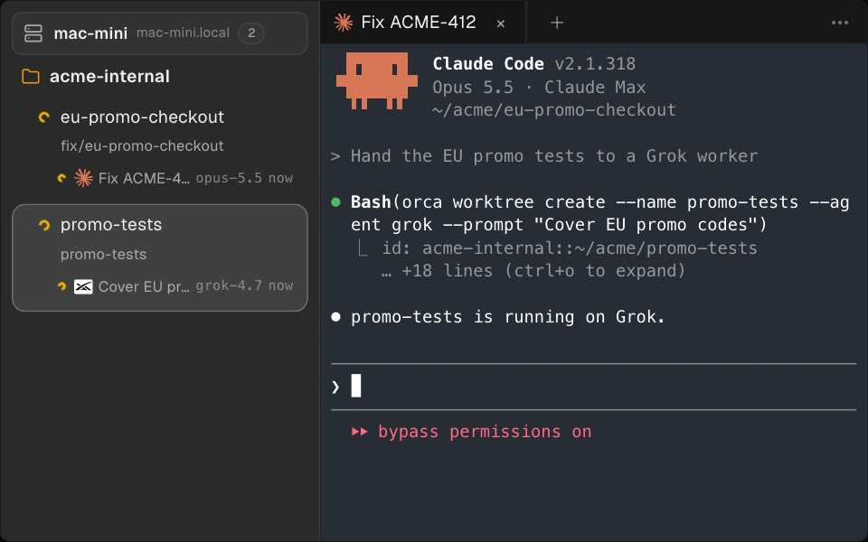
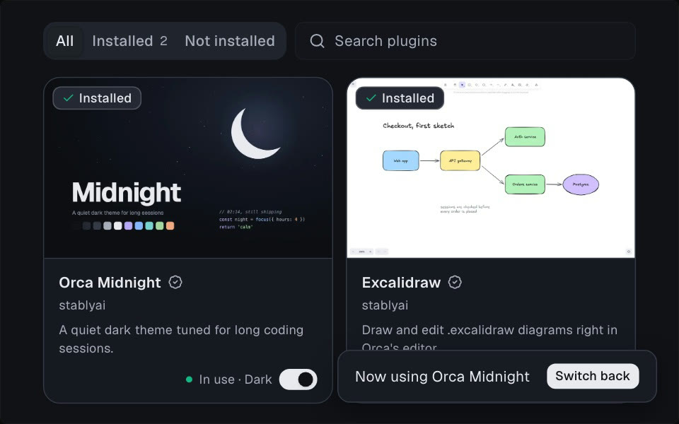

<h1 align="center">
   Orca NP
</h1>

  
  
  
  

  <a href="docs/readme/README.zh-CN.md">中文</a> · <a href="docs/readme/README.ja.md">日本語</a> · <a href="docs/readme/README.ko.md">한국어</a> · <a href="docs/readme/README.es.md">Español</a> · <a href="docs/readme/README.fr.md">Français</a> · <a href="docs/readme/README.pt.md">Português</a> · <a href="docs/readme/README.tr.md">Türkçe</a> · <a href="docs/readme/README.ru.md">Русский</a>

  <strong>🔱 This is <a href="#whats-different-in-this-fork">Orca NP</a> — a fork of <a href="https://github.com/stablyai/orca">stablyai/orca</a> with its own features, fixes, and releases.</strong> 
  Installs beside the official Orca · <a href="https://github.com/nplez1/orca/releases/latest">Download the latest Orca NP build</a> · <a href="#whats-different-in-this-fork">See what's different ↓</a>

  <strong>The AI Orchestrator for 100x builders.</strong> 
  Run Claude Code, Codex, and any other coding agent in parallel, each in its own worktree. Chat or terminal, on your laptop or in the cloud, with diffs, a browser, and a CLI in one app.

<h3 align="center"><a href="https://github.com/nplez1/orca/releases/latest"><ins>Download Orca NP</ins></a></h3>

  

## What's different in this fork

Orca NP is [stablyai/orca](https://github.com/stablyai/orca) plus a series of fork-only features and fixes. The upstream feature list below still applies (except where a build isn't published here — see [Install](#install)); this is what Orca NP adds on top. The full list is in the [merged pull requests](https://github.com/nplez1/orca/pulls?q=is%3Apr+is%3Amerged), and the fork-only patch series is documented in [`LOCAL-PATCHES.md`](LOCAL-PATCHES.md).

### Tasks, issues, and Jira

- **Jira board view** — pick a default board and the Jira tab shows columns, the active sprint, and the backlog, with drag-to-move between columns, a filter box, and priority colors.
- **Lane drops that stick** — dropping a Jira item on a lane resolves the transition, asks for the fields that transition's screen requires, and moves the card before Jira confirms it, rolling back only if Jira refuses.
- **Sprints, story points, and custom fields** — move a backlog item onto a sprint from its row or the issue drawer, set or clear story points beside status, priority, and assignee, and edit custom user-picker fields (Dev, QE) from the issue detail. A sprint change made in the open issue reloads the board.
- **"Me" matches every role field** — an issue where you are the Dev or the QE, not only the assignee, now appears under the board's Me filter.
- **Searchable assignee picker** — with you and your team pinned to the top.
- **Linked issue in the right sidebar** — a workspace created from a Jira, Linear, or GitHub issue gets an Issue tab with status, assignee, priority, labels, description, and an Open button. Jira issues also get unlink/re-link, a live Markdown comment box, and correct rendering of self-hosted Jira (Server/Data Center) descriptions. A GitHub issue is read from the repo it came from, so a workspace in another project still loads it, and when that repo is not on this machine, the tab says so instead of failing.
- **Link a workspace to a Jira issue** by key or URL from its details dialog; the Tasks page shows an attached-workspace chip and opens the existing workspace instead of creating a duplicate.

### Pull request review and CI

- **Inline GitHub PR comments** — comments appear under their line in the editor, with reply, resolve, and collapse (shown only when your checkout matches the PR's head commit).
- **Merge readiness at a glance** — the PR icon keeps its CI color and adds a dot for outstanding approvals, conflicts, or blocks, with the reason in the tooltip. Works across GitHub, GitLab, Bitbucket, Azure DevOps, and Gitea.
- **Review verdicts in the Checks panel** — Approved / Changes requested with reviewer names, and the panel updates when CI changes instead of waiting for a tab switch.
- **A live Checks panel** — while a run is in flight an open panel refreshes every 10s instead of waiting out the review cadence, slowing to 20s and then 30s while nothing changes, and its verdict updates the sidebar card and activity-bar icons (GitHub).
- **Jenkins build details** — expand a Jenkins check to see its stages, which one is running or failed, and the build facts.
- **Admin merge for review-gated PRs** — if your account may bypass branch protection, Merge is offered after a confirmation that names what gets skipped.

### Agents

- **Session summaries** — a written brief of an agent session (activity, goal, plan, blockers, timeline) in the right sidebar, with its own agent/model setting. Covers Pi, Copilot, OpenCode, and Cursor sessions as well; a session on a paired host is briefed on that host, and one on an SSH target is briefed from its streamed transcript.
- **More accurate agent status** — Pi rows no longer stick on "Working" or turn "Done" when a helper sub-agent finishes; Copilot CLI no longer raises "needs you" for auto-approved prompts; a Grok sub-agent waiting on you keeps its row waiting; a pane restored on another client drops the needs-input marker its dialog left behind; and a Claude sub-agent a pi session launches through the `claude` CLI stays on the pi session's row (needs a current pi-subagents plugin).
- **Copilot's prompts are read from the screen** — a shell or URL approval and the "Copilot needs information" dialog show as prompts instead of a spinner, while a permission the CLI approved on its own stays quiet.
- **Focus stays in the agent tab** — clicking a sidebar card, a right-sidebar activity tab, or the panel background hands the keyboard back to the agent tab, and closing a menu or dialog returns the caret too, so the next keystroke still means what it did.
- **Clipboard follows the reader** — a copy from a pi pane watched from a paired client lands in that client's clipboard as well as the host's.
- **One-click default agent** — the `+` button in the tab bar launches your default agent; hold it or use the chevron for the full menu.
- **Agent Dashboard as a page** — opens in the main window with back/forward, and clicking a card opens that agent's workspace.
- **Agent session history** — "All" really lists every session, sub-agent sessions nest under their parent, and transcript indexing makes existing transcripts searchable. A paired host's history loads in pages and refreshes only what changed, so a large remote history arrives instead of failing.
- **Usage tracking for more providers** — Copilot enterprise AI-credit budgets, DeepSeek balance, and Fireworks.ai spend in the status bar, plus a per-provider off switch that stops polling and credential reads. An expired Claude login is refreshed from the stored refresh token rather than sitting at "Updates when Claude runs", and the renewed login is saved back where Claude keeps it.

### Workspaces and layout

- **One folder per project** — the main checkout and all its worktrees live together under one folder with a shared `AGENTS.md`; `orca repo relocate` moves existing checkouts into it.
- **Grouped workspaces across machines** — the same branch on two hosts becomes one card with a host dropdown. A workspace on a paired host reads its GitHub issue and PR from that host, and its status dot stops spinning once the host's agents finish.
- **Paired clients stay in step** — projects and workspaces a host adds or removes, including ones created in that host's own window or from its CLI, reach its paired clients without a manual refresh.
- **Status filter** — hide chosen statuses from the sidebar and Cmd+J while the board still shows everything.
- **"Setting up…" indicator** while a repo's setup script runs, including for workspaces started without an agent.
- **Shared-directory modes** — symlink, APFS clone, copy, or skip for directories shared between worktrees.
- **Floating workspace** — a home folder of its own, a drag handle on the titlebar, and the same agent launch control as the main tab bar.
- **Hide auto-imported SSH hosts** from pickers and the status bar; hidden hosts stay listed under Settings.
- **Faster, honest file filter** — the Explore filename filter searches the whole workspace from a prebuilt index and says so when results are partial instead of "no files match".
- **Host settings replication** _(groundwork)_ — one machine's settings and provider credentials can be replicated to paired hosts.

### Ephemeral environments

Additions to upstream's per-workspace environment recipes (Settings → Experimental → Cloud VM):

- **Lease countdown and Extend** — a recipe that publishes when the provider takes the host away gets a countdown on the workspace card and in Settings, and, when it also declares how to extend, an Extend action limited to the lifetimes it lists. Past the deadline the card and Settings show the lease as expired; once a further 15 minutes have passed and Orca's connection to the host has failed, Orca removes the workspace from its list, and the provider's machine is left to its own expiry or to Cleanup in Settings.
- **Recipe-declared context-menu items** — up to 20 actions a recipe declares get their own entries in that workspace's context menu and run with the workspace's host, name, and path. They are declared in `orca.yaml`, so they are covered by the recipe's approval, and a recipe that declares none adds no entries.

### Reliability

- Git hooks and ssh-agent auth work when the packaged app is launched from the Dock, because git now sees the exports from your shell profile.
- macOS computer-use permissions no longer split across two helper identities.
- Right-click paste into Copilot CLI pastes once, not twice.
- An opt-in "Log UI hangs" diagnostic writes stall records, with focus, sleep, and CPU context, to help track down beachballs.

### Running it

- **Own identity** — Orca NP uses its own app id (`com.nplez1.orca`), data directory, home directory (`~/.orca-np`), and CLI (`orca-np`), so it installs and runs beside an official Orca without sharing state.
- **Own releases and updates** — builds are tagged `v<upstream version>-np.<n>` and the in-app updater follows [this repository's releases](https://github.com/nplez1/orca/releases), not upstream's.
- **Signing** — macOS builds are signed and notarized; the Windows installer is unsigned, so SmartScreen warns once on install.
- **No telemetry** — the release notes state that builds send no diagnostics or usage data.
- **Skills point at this app** — bundled skills and the published stubs call `orca-np` (and `orca-np-dev` in development) rather than falling through to an official install's `orca`.
- **Fresh profile** — Orca NP cannot read an official Orca install's repos, credentials, or paired devices; that separation is deliberate, so pair your phone with Orca NP separately.
- **Tracks upstream** — upstream `main` is merged in regularly (the procedure is in [`UPSTREAM-SYNC-RUNBOOK.md`](UPSTREAM-SYNC-RUNBOOK.md)), so the fork receives upstream features and fixes too.

---

## Features

The feature wall below is upstream Orca's; its "Docs" links go to upstream's documentation at onorca.dev, which doesn't cover the fork-only features above.

<table>
<tr>
<td width="50%" valign="middle">

### Orchestrate Agents

Hand a big task to one agent. It splits the work, starts worker agents in their own workspaces, and brings their results back to you.

[Docs →](https://www.onorca.dev/docs/cli/orchestration)

</td>
<td width="50%">
  <a href="https://www.onorca.dev/docs/cli/orchestration"><picture><source srcset="docs/assets/readme-features/orchestration.webp" type="image/webp"></picture></a>
</td>
</tr>
<tr>
<td width="50%" valign="middle">

### Chat or Terminal

Run any agent in Chat UI or as the raw CLI, and move a conversation between the two without losing context.

[Docs →](https://www.onorca.dev/docs/agents/native-chat)

</td>
<td width="50%">
  <a href="https://www.onorca.dev/docs/agents/native-chat"><picture><source srcset="docs/assets/readme-features/chat-or-terminal.webp" type="image/webp"></picture></a>
</td>
</tr>
<tr>
<td width="50%" valign="middle">

### Run Anywhere

Pair a Remote Orca Server, work on any SSH host, or give a worktree its own cloud VM. Your agents keep running when your laptop sleeps.

[Docs →](https://www.onorca.dev/docs/ways-to-run)

</td>
<td width="50%">
  <a href="https://www.onorca.dev/docs/ways-to-run"><picture><source srcset="docs/assets/readme-features/remote.webp" type="image/webp"></picture></a>
</td>
</tr>
<tr>
<td width="50%" valign="middle">

### Mobile App

Pair Orca with the mobile app to get pinged when an agent needs you, reply in chat, and keep work moving on any of your machines when you are away from your desk.

[iOS App Store](https://apps.apple.com/us/app/orca-ide/id6766130217) · [Android APK](https://www.onorca.dev/download/android) · [Docs →](https://www.onorca.dev/docs/mobile)

</td>
<td width="50%">
  <a href="https://www.onorca.dev/docs/mobile"><picture><source srcset="docs/assets/readme-features/mobile-companion.webp" type="image/webp"></picture></a>
</td>
</tr>
<tr>
<td width="50%" valign="middle">

### Review AI Output

Review diffs, leave notes on exact changed lines, and send focused feedback back to an agent.

[Docs →](https://www.onorca.dev/docs/review/annotate-ai-diff)

</td>
<td width="50%">
  <a href="https://www.onorca.dev/docs/review/annotate-ai-diff"><picture><source srcset="docs/assets/readme-features/annotate-ai-diffs.webp" type="image/webp"></picture></a>
</td>
</tr>
<tr>
<td width="50%" valign="middle">

### Git Integration

Draft commit messages and pull requests from the diff, then send failing checks or PR review comments back to an agent to fix.

[Docs →](https://www.onorca.dev/docs/review/commit-push)

</td>
<td width="50%">
  <a href="https://www.onorca.dev/docs/review/commit-push"><picture><source srcset="docs/assets/readme-features/git-integration.webp" type="image/webp"></picture></a>
</td>
</tr>
<tr>
<td width="50%" valign="middle">

### Parallel Worktrees

Quickly split tasks into isolated environments, so multiple agents can work side by side without interfering with each other.

[Docs →](https://www.onorca.dev/docs/model/worktrees)

</td>
<td width="50%">
  <a href="https://www.onorca.dev/docs/model/worktrees"><picture><source srcset="docs/assets/readme-features/parallel-worktrees.webp" type="image/webp"></picture></a>
</td>
</tr>
<tr>
<td width="50%" valign="middle">

### Design Mode

Click any element in Orca's browser to copy its HTML, styles, and selector, then paste it into your agent's chat.

[Docs →](https://www.onorca.dev/docs/browser/design-mode)

</td>
<td width="50%">
  <a href="https://www.onorca.dev/docs/browser/design-mode"><picture><source srcset="docs/assets/readme-features/design-mode.webp" type="image/webp"></picture></a>
</td>
</tr>
<tr>
<td width="50%" valign="middle">

### GitHub &amp; Linear, Native

See your GitHub and Linear tasks in one place, and start a workspace for each when you're ready to build.

[Docs →](https://www.onorca.dev/docs/review/linear)

</td>
<td width="50%">
  <a href="https://www.onorca.dev/docs/review/linear"><picture><source srcset="docs/assets/readme-features/github-linear-tasks.webp" type="image/webp"></picture></a>
</td>
</tr>
<tr>
<td width="50%" valign="middle">

### Orca CLI

Anything you can do in Orca, your agents can do too: create worktrees, start workers, drive the browser and desktop apps, and schedule automations, all from the command line.

[Docs →](https://www.onorca.dev/docs/cli/overview)

</td>
<td width="50%">
  <a href="https://www.onorca.dev/docs/cli/overview"><picture><source srcset="docs/assets/readme-features/orca-cli.webp" type="image/webp"></picture></a>
</td>
</tr>
<tr>
<td width="50%" valign="middle">

### Plugins

Themes, editors, languages, and panels from the community, installed in a click.

[Browse plugins →](https://www.onorca.dev/plugins)

</td>
<td width="50%">
  <a href="https://www.onorca.dev/plugins"><picture><source srcset="docs/assets/readme-features/plugins.webp" type="image/webp"></picture></a>
</td>
</tr>
<tr>
<td width="50%" valign="middle">

### Split Anything

Put agents, terminals, browsers, and diffs side by side in split panes shaped to the task.

[Docs →](https://www.onorca.dev/docs/model/tabs-panes-splits)

</td>
<td width="50%">
  <a href="https://www.onorca.dev/docs/model/tabs-panes-splits"><picture><source srcset="docs/assets/readme-features/split-anything.webp" type="image/webp"></picture></a>
</td>
</tr>
</table>

**Also in the box:**

- **[Drag Files to Agents](https://www.onorca.dev/docs/editing/file-explorer)**: drag files from the explorer, or images from your desktop, straight into an agent's prompt.
- **[Jump Anywhere](https://www.onorca.dev/docs/model/quick-open)**: one shortcut jumps to any workspace or tab across every repo and host.
- **[Rich Previews](https://www.onorca.dev/docs/editing/viewers)**: open images, PDFs, and Markdown right in the workspace, next to the agent that made them.
- **[Mobile Emulator](https://www.onorca.dev/docs/cli/overview#mobile-emulator)**: run an iOS Simulator or Android emulator beside your agent, and let it tap, type, and check its own work.
- **[Dictation](https://www.onorca.dev/docs/settings#voice)**: press a shortcut and talk. Orca types what you say into the agent's prompt or terminal.
- **[Usage &amp; Accounts](https://www.onorca.dev/docs/agents/usage-tracking)**: see how much of your agent limits you've used and when they reset, and switch accounts without logging out.
- **[Automations](https://www.onorca.dev/docs/cli/automations)**: schedule prompts to run on any repo: nightly dependency bumps, weekly triage, flaky-test sweeps.
- **[Computer Use](https://www.onorca.dev/docs/cli/computer-use)**: when there's no CLI or API, agents can see and drive desktop apps and external browsers.
- **And many, many more**: we ship daily, so this list is perpetually behind. The [Orca NP releases](https://github.com/nplez1/orca/releases) are the real feature list for this fork, and [upstream's](https://github.com/stablyai/orca/releases) for everything it inherits.

---

## Supported Agents

Works with **any CLI agent** — if it runs in a terminal, it runs in Orca.

  <a href="https://docs.anthropic.com/claude/docs/claude-code"><kbd> Claude Code</kbd></a> &nbsp;
  <a href="https://github.com/openai/codex"><kbd> Codex</kbd></a> &nbsp;
  <a href="https://x.ai/cli"><kbd> Grok</kbd></a> &nbsp;
  <a href="https://cursor.com/cli"><kbd> Cursor</kbd></a> &nbsp;
  <a href="https://docs.github.com/en/copilot/how-tos/set-up/install-copilot-cli"><kbd> GitHub Copilot</kbd></a> &nbsp;
  <a href="https://dev.meta.ai/docs/muse-code"><kbd> Muse</kbd></a> &nbsp;
  <a href="https://deepseek-harness.github.io/deepseek-harness/"><kbd> DeepSeek Harness</kbd></a> &nbsp;
  <a href="https://zcode.z.ai/en/docs"><kbd> ZCode</kbd></a> &nbsp;
  <a href="https://opencode.ai/docs/cli/"><kbd> OpenCode</kbd></a> &nbsp;
  <a href="https://mimo.xiaomi.com/coder"><kbd> MiMo Code</kbd></a> &nbsp;
  <a href="https://ampcode.com/manual#install"><kbd> Amp</kbd></a> &nbsp;
  <a href="https://openclaude.gitlawb.com/"><kbd> OpenClaude</kbd></a> &nbsp;
  <a href="https://antigravity.google/docs/cli-overview"><kbd> Antigravity</kbd></a> &nbsp;
  <a href="https://pi.dev"><kbd> Pi</kbd></a> &nbsp;
  <a href="https://omp.sh"><kbd> oh-my-pi</kbd></a> &nbsp;
  <a href="https://hermes-agent.nousresearch.com/docs/"><kbd> Hermes Agent</kbd></a> &nbsp;
  <a href="https://devin.ai/cli"><kbd> Devin</kbd></a> &nbsp;
  <a href="https://goose-docs.ai/docs/quickstart/"><kbd> Goose</kbd></a> &nbsp;
  <a href="https://docs.augmentcode.com/cli/overview"><kbd> Auggie</kbd></a> &nbsp;
  <a href="https://github.com/autohandai/code-cli"><kbd> Autohand Code</kbd></a> &nbsp;
  <a href="https://github.com/charmbracelet/crush"><kbd> Charm</kbd></a> &nbsp;
  <a href="https://docs.cline.bot/cline-cli/overview"><kbd> Cline</kbd></a> &nbsp;
  <a href="https://www.codebuddy.ai/cli"><kbd> CodeBuddy</kbd></a> &nbsp;
  <a href="https://www.codebuff.com/docs/help/quick-start"><kbd> Codebuff</kbd></a> &nbsp;
  <a href="https://freebuff.com"><kbd> Freebuff</kbd></a> &nbsp;
  <a href="https://commandcode.ai/docs/quickstart"><kbd> Command Code</kbd></a> &nbsp;
  <a href="https://docs.continue.dev/cli/quickstart"><kbd> Continue</kbd></a> &nbsp;
  <a href="https://docs.factory.ai/cli/getting-started/quickstart"><kbd> Droid</kbd></a> &nbsp;
  <a href="https://kilo.ai/docs/cli"><kbd> Kilocode</kbd></a> &nbsp;
  <a href="https://www.kimi.com/code/docs/en/kimi-code-cli/getting-started.html"><kbd> Kimi</kbd></a> &nbsp;
  <a href="https://kiro.dev/docs/cli/"><kbd> Kiro</kbd></a> &nbsp;
  <a href="https://github.com/mistralai/mistral-vibe"><kbd> Mistral Vibe</kbd></a> &nbsp;
  <a href="https://github.com/QwenLM/qwen-code"><kbd> Qwen Code</kbd></a> &nbsp;
  <a href="https://support.atlassian.com/rovo/docs/install-and-run-rovo-dev-cli-on-your-device/"><kbd> Rovo Dev</kbd></a> &nbsp;
  <kbd>+ any CLI agent</kbd>

---

## Install

### Desktop — macOS, Windows, Linux

- **[Download the latest Orca NP release](https://github.com/nplez1/orca/releases/latest)**
- Or grab a build directly: [macOS Apple Silicon](https://github.com/nplez1/orca/releases/latest/download/orca-macos-arm64.dmg) · [macOS Intel](https://github.com/nplez1/orca/releases/latest/download/orca-macos-x64.dmg) · [Windows (.exe)](https://github.com/nplez1/orca/releases/latest/download/orca-windows-setup.exe) · [Linux (AppImage)](https://github.com/nplez1/orca/releases/latest/download/orca-linux.AppImage) · [All builds](https://github.com/nplez1/orca/releases)

Orca NP installs beside an official Orca and updates itself from this repository's releases. The
Linux build is x86_64 only: the AppImage updates itself, while the `.deb` and `.rpm` install the same
app under a package manager and are updated by installing a newer release. This fork does not publish
a Homebrew/AUR package.

### Mobile App — iOS, Android

Pair the Orca mobile app with Orca NP to monitor and steer your agents from your phone. The apps are published by upstream Orca and work with Orca NP.

- **iOS:** [Download on the App Store](https://apps.apple.com/us/app/orca-ide/id6766130217)
- **Android:** [Download APK](https://www.onorca.dev/download/android) · [Install guide](https://www.onorca.dev/docs/android-apk)

---

## Community &amp; Support

- **Orca NP issues &amp; ideas:** [Open an issue](https://github.com/nplez1/orca/issues) for anything specific to this fork.
- **Upstream community:** upstream Orca's channels cover everything this fork inherits — [Discord](https://discord.gg/fzjDKHxv8Q), [@orca_build on X](https://x.com/orca_build), and [upstream issues](https://github.com/stablyai/orca/issues) for bugs that also reproduce in official Orca.
- **Upstream WeChat group:** Scan to join an Orca community WeChat group. If one group is full, join another.

  
  
  

- **Docs:** [onorca.dev/docs](https://www.onorca.dev/docs) documents upstream Orca.
- **Show support:** [Star](https://github.com/nplez1/orca) this repo to follow the fork, or [upstream](https://github.com/stablyai/orca).

---

## Developing

Want to contribute or run locally? See our [CONTRIBUTING.md](.github/CONTRIBUTING.md) guide.

The relay that pairs the mobile app with a desktop host is also in this repository under
[`cloud/`](cloud/README.md), with a separate pnpm workspace and setup guide.

## Signed Builds

Orca NP's Windows installer is unsigned. Upstream Orca's Windows builds are signed with code signing sponsored by [SignPath.io](https://signpath.io), certificate by [SignPath Foundation](https://signpath.org).

## License

Orca is free and open source under the [MIT License](LICENSE).
